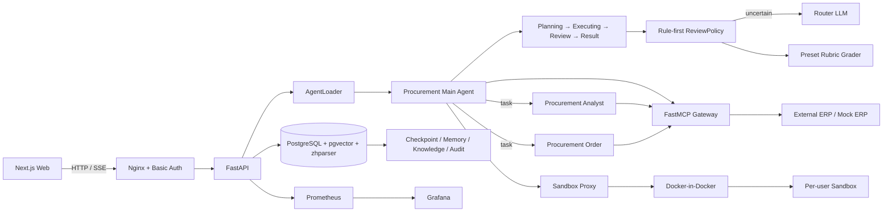

# autosupply-agent

面向汽车与摩托车零部件采购场景的全栈 Agent 系统。项目以 DeepAgents 与 LangGraph
为执行底座，通过 Planning、Executing、Review、Result 四阶段 Harness 编排采购分析、
缺料计算、供应商查询、库存操作和采购订单处理，并以 MCP 隔离 Agent 与 ERP 接口。

系统同时提供规则优先、LLM 兜底的质量评审，写操作前人工审批，写后持久化审计与对账，
以及用户级 Docker 沙箱、三层记忆、SSE 前端和容器化部署能力。

## 核心能力

- **Harness 编排与评审**：使用图状态维护 Planning、Executing、Review、Result 四阶段；
  `ReviewPolicy` 先执行确定性规则，无法判断时调用 Router LLM，超时或 Schema 无效时保守评审；
  采购查询任务完成率约 91%。
- **固定 Rubric 与安全返工**：LLM 只决定是否评审及检查维度，具体标准从 YAML 预设中选择；
  多工具、写操作、委派和失败信号会升级审查。只读任务最多返工 3 轮，写入及委派任务只评审一次，
  不自动重放副作用链路。
- **主 Agent 与两个子 Agent**：主 Agent 通过 DeepAgents 的 `task` 工具按需选择采购分析或
  订单操作子 Agent；服务端从可信 `configurable` 自动注入用户身份、偏好和 WARM 记忆，
  不要求主 Agent 在委派文本中重复传递上下文。
- **MCP 采购网关**：FastMCP 封装供应商、零部件、订单、库存和缺料五组工具，通过 HTTP
  对接外部 ERP；仓库自带行为一致的 Mock ERP，可脱离未开源业务系统运行。
- **审批、评审与审计分层**：审批在 ERP 写入前阻断执行，Rubric 在执行后检查结果质量，
  写审计则持久化操作事实。三者职责独立，但主 Agent 直调和子 Agent 调用共享同一审批策略中心。
- **通用写治理**：订单、库存、供应商和零部件写入统一生成操作记录与追加式审计事件；
  使用 `thread_id + tool_call_id` 保证调用幂等，ERP 终态未知时进入补偿对账，不因审计保存失败重复写入；
  错误拦截率 100%。
- **三层记忆**：HOT 使用 LangGraph checkpoint，WARM 在每次新请求或 HITL resume 时生成请求级快照，
  COLD 使用 PostgreSQL 中文全文检索与 pgvector 召回，通过 RRF 融合并维护访问频次、TTL、容量和冲突失效。
- **用户级安全沙箱**：每个用户领取独立 Docker 沙箱，应用只读根文件系统、tmpfs、资源上限、
  Capability 裁剪、seccomp 和 PID 限制；预热池、generation 热替换、受控 workspace 探针和
  3 次基础设施故障 / 60 秒熔断共同处理运行时故障。
- **全栈交付**：FastAPI 提供 SSE、HITL 恢复、历史、写审计、评测指标和文件下载接口；
  Next.js 前端展示阶段、工具调用、审批和结果；Nginx、Prometheus、Grafana 与 GitHub Actions
  覆盖认证、观测、测试、构建、备份、发布和回滚。

## 系统架构



单轮执行主链如下：

```text
请求或 HITL resume
  └─ 刷新用户 WARM 记忆快照
      └─ Planning
          └─ Executing
              ├─ 主 Agent 直接调用工具
              └─ task 委派采购分析 / 订单操作子 Agent
                  └─ ReviewPolicy
                      ├─ review    → 注入预设 Rubric
                      ├─ skip      → 直接输出
                      └─ uncertain → Router LLM → review / skip
                          └─ 执行信号再次升级审查
                              ├─ 只读任务：最多 3 轮定向返工
                              ├─ 写入/委派：单次审查，禁止自动重放
                              └─ Result
```

写操作另有独立的副作用链路：

```text
ERP 写工具
  └─ ApprovalPolicyRegistry
      └─ LangGraph interrupt
          ├─ reject  → REJECTED，不调用 ERP
          └─ approve → 写审计预登记 → ERP 调用
                           ├─ 明确成功/失败 → 保存终态
                           └─ UNKNOWN       → 补偿任务查询 ERP → 对账或人工处理
```

## 技术栈

| 层次 | 技术 |
|---|---|
| Agent | DeepAgents 0.7、LangGraph 1.2、LangChain、OpenAI-compatible LLM |
| API / 工具 | FastAPI、SSE、FastMCP、HTTPX |
| 数据 | PostgreSQL 16、pgvector、zhparser、LangGraph PostgresSaver / Store |
| 沙箱 | Docker SDK、Docker-in-Docker、seccomp、用户级资源隔离 |
| 前端 | Next.js 16、React 19、TypeScript、Tailwind CSS 4 |
| 可观测性 | Prometheus、Grafana、结构化 Harness trace、追加式写审计 |
| 交付 | Docker Compose、Nginx、GitHub Actions、Release Please |

## 目录结构

```text
autosupply-agent/
├─ src/
│  ├─ agent/
│  │  ├─ main_agent.py             主 Agent、工具、子 Agent 与中间件组装
│  │  ├─ harness.py                四阶段状态与 HarnessPhaseMiddleware
│  │  ├─ review_policy.py          规则优先、LLM 兜底的统一评审路由
│  │  ├─ harness_config.yaml       阶段、路由配置与预设 Rubric
│  │  ├─ approval.py               写工具审批策略唯一来源
│  │  ├─ audit/                    写操作审计、状态机、对账与补偿任务
│  │  ├─ backends/                 Docker 沙箱、预热池、Proxy 与生命周期管理
│  │  ├─ middlewares/              评审、写治理、记忆、Skills 与沙箱中间件
│  │  ├─ subagents/                采购分析 / 订单操作 YAML 配置
│  │  ├─ memory/                   Semantic / Episodic / Procedural 三类记忆
│  │  ├─ knowledge/                采购知识检索、RRF、证据与有界补搜
│  │  ├─ shortage/                 缺料计算、建议固化与结果审计
│  │  └─ tools/                    图表、文档、知识、记忆、下载与 HITL 工具
│  ├─ api_view/                    FastAPI、SSE、认证、历史、审计与评测 API
│  ├─ mcp_server/                  供应商、零部件、订单、库存、缺料 MCP 工具
│  ├─ skills/                      Agent Skills
│  ├─ test/evaluation/             Golden 回归与 JSON 指标报告
│  ├─ artifacts.py                 用户隔离临时文件与 TTL 清理
│  └─ database.py                  PostgreSQL 连接池及应用 Schema 初始化
├─ frontend/                       Next.js 16 Web 前端
├─ deploy/
│  ├─ postgres/                    pgvector + zhparser PostgreSQL 镜像
│  ├─ mock-erp/                    可独立运行的采购 ERP 替身
│  ├─ sandbox/                     预装分析依赖的沙箱镜像
│  ├─ nginx/                       统一入口、认证与 TLS
│  ├─ prometheus/ / grafana/       指标采集、告警与 Dashboard
│  ├─ ci/                          集成栈、备份恢复和迁移门禁
│  ├─ cd/                          构建、发布、观察窗与回滚
│  ├─ dr/                          PostgreSQL 备份、恢复与演练
│  └─ cloud/                       新云主机初始化脚本
├─ .github/workflows/              CI、构建、发布与 Release Please
├─ docker-compose.yml              全栈服务编排
├─ Dockerfile                      Backend / MCP 共用镜像
└─ eval.md                         采购查询与错误拦截评测方案
```

## 环境要求

- Docker Engine 24+ 与 Docker Compose v2
- 本地开发：Python 3.11、Node.js 22、npm 10+
- 至少 4 GB 可用内存；增加预热沙箱数量时需要同步增加资源
- 可用的 OpenAI-compatible LLM Key；默认配置使用 ChatAnywhere
- Linux 服务器建议使用 ext4，或启用 `ftype=1` 的 xfs

## 快速启动

Docker Compose 是最完整的运行方式，会启动 PostgreSQL、Mock ERP、MCP、Backend、
Frontend、Docker 沙箱、Prometheus、Grafana 和 Nginx。

### 1. 准备配置

```bash
git clone https://github.com/farhub-wq/autosupply-agent.git
cd autosupply-agent

cp deploy/.env.example deploy/.env
cp deploy/nginx.env.example deploy/nginx.env
```

编辑 `deploy/.env`，至少设置：

```dotenv
CHATANYWHERE_API_KEY=sk-xxxx
PUBLIC_BASE_URL=http://localhost
POSTGRES_PASSWORD=请替换为强密码
```

生成 Nginx 与 Backend 共用的内部认证 Token：

```bash
sh deploy/set_internal_token.sh
```

### 2. 创建登录凭据和 TLS 占位证书

```bash
docker run --rm httpd:2.4-alpine \
  htpasswd -nbB admin '请替换为登录密码' > deploy/nginx/htpasswd

mkdir -p deploy/nginx/tls
openssl req -x509 -newkey rsa:2048 -nodes -days 3650 \
  -keyout deploy/nginx/tls/key.pem \
  -out deploy/nginx/tls/cert.pem \
  -subj '/CN=localhost'
chmod 600 deploy/nginx/tls/key.pem
```

占位证书用于保证 Nginx 配置可加载。公网生产环境应在 `deploy/nginx.env` 中设置
`TLS_ENABLED=1`，并替换为可信证书。

### 3. 启动并验收

```bash
docker compose up -d --build
docker compose ps
curl http://localhost/healthz
```

访问 <http://localhost/> 并使用刚创建的 Basic Auth 账号登录。Grafana 默认位于
<http://localhost:13000/>。

首次启动时应用会幂等创建业务 Schema，LangGraph 会创建 checkpoint 与 store 表，
记忆检索会在 store 表上补充中文全文检索和向量字段。

### 4. 新云主机部署

新服务器建议使用自动化初始化脚本，它会安装 Docker、生成配置、准备 TLS、创建账号并等待
所有服务健康：

```bash
bash deploy/cloud/pack.sh /tmp/agent-harness.tar.gz
# 将压缩包传到目标机器后，按 deploy/cloud/README.md 执行 bootstrap.sh
```

完整说明见 [deploy/cloud/README.md](deploy/cloud/README.md)。

## 本地分进程开发

先准备依赖与本地配置：

```bash
python -m venv .venv
# Linux / WSL
source .venv/bin/activate
# Windows PowerShell: .venv\Scripts\Activate.ps1

python -m pip install -r requirements-dev.txt
cp .env.example .env

cd frontend
npm ci
cd ..
```

本地需要可访问的 PostgreSQL 16（含 pgvector 与 zhparser）和 Docker daemon。建议先构建
项目提供的镜像：

```bash
docker build -t agent-harness-postgres deploy/postgres
docker run -d --name agent-harness-postgres \
  -e POSTGRES_USER=erp_agent \
  -e POSTGRES_PASSWORD=erp_agent \
  -e POSTGRES_DB=erp_agent \
  -p 5432:5432 agent-harness-postgres

docker build -f deploy/sandbox/Dockerfile \
  -t erp-sandbox:3.11 deploy/sandbox
```

将根目录 `.env` 中的 `SANDBOX_IMAGE` 设置为 `erp-sandbox:3.11`，即可使用该预装镜像。

分别启动四个进程：

```bash
# 终端 1：Mock ERP
python deploy/mock-erp/erp_mock_server.py

# 终端 2：MCP
python -m src.mcp_server.server_main

# 终端 3：Backend
python -m src.api_view.web_main

# 终端 4：Frontend
cd frontend && npm run dev
```

本地模式访问 <http://localhost:3000/>。`MCP_SERVER_URL`、`ERP_BASE_URL`、
`DATABASE_URL` 和 `SANDBOX_IMAGE` 以根目录 `.env` 为准。

## 记忆与知识检索

系统按用户隔离四个命名空间：

| 类型 | 内容 | 写入方式 |
|---|---|---|
| Semantic | 稳定偏好与用户画像 | 从一个 thread 的全部用户消息增量提取；新值使旧版本失效 |
| Episodic | 一次业务任务的目标、结论和真实工具结果 | 每轮结束更新固定的 `ep_{thread_id}` |
| Procedural | 可复用经验、流程和操作约定 | 通过 `remember` 显式保存 |
| Org Policy | 组织级只读规则 | 由服务端维护 |

项目约束为“一个 thread 对应一个完整业务任务；新任务创建新 thread”。WARM 层注入有效
Semantic 和近期 Episodic；更早内容由 `read_memory` 从 COLD 层按需检索。

COLD 检索采用：

```text
用户权限过滤
  → PostgreSQL zhparser 关键词召回 + pgvector 语义召回
  → RRF 融合与去重
  → 时间、访问频次、置信度有限增益
  → Top-K 与访问统计更新
```

## 评测

当前评测链提供确定性 Golden 回归、JSON 报告和指标 API：

```bash
python -m unittest src.test.evaluation.test_shortage_golden_evaluation -v
curl http://localhost:8000/api/evaluation/metrics
```

核心指标口径：

```text
采购查询任务完成率
= 通过任务目标、关键事实、工具证据和输出约束检查的查询数
  / 采购查询总数

错误拦截率
= 被审批、参数校验、写治理或结果审计正确阻断的错误写入数
  / 错误写入用例总数
```

评测服务只输出 JSON，Dashboard 由外部业务前端展示。完整的数据格式、冻结 ERP 快照、
金标生成和用例隔离方案见 [eval.md](eval.md)。

## 测试与质量门禁

```bash
# Python
ruff check .
python -m compileall -q src
pytest -v --cov --cov-report=term-missing

# Frontend
cd frontend
npm run typecheck
npm run lint
npm run test
npm run build
```

GitHub Actions 使用同一份可复用门禁，覆盖：

- Workflow 权限与触发安全检查
- Gitleaks 全历史密钥扫描和敏感路径检查
- Python lint、编译、离线回归与覆盖率
- 前端类型、lint、测试与镜像构建
- PostgreSQL 备份恢复、迁移幂等与负向用例
- Nginx 认证链路、完整 Compose 拓扑和真实沙箱冒烟
- 后端、前端、PostgreSQL 与 Mock ERP 镜像构建验证

## 关键接口

| 方法 | 路径 | 用途 |
|---|---|---|
| `POST` | `/api/chat/stream` | 创建或继续 thread，以 SSE 返回阶段、Token、工具和中断事件 |
| `POST` | `/api/chat/{thread_id}/resume` | 提交审批或补充信息并恢复 LangGraph |
| `GET` | `/api/chat/{thread_id}/state` | 查询中断及待处理状态 |
| `GET` | `/api/chat/{thread_id}/history` | 获取会话展示消息 |
| `GET` | `/api/history` | 获取当前用户的会话列表 |
| `DELETE` | `/api/history/{thread_id}` | 删除当前用户会话 |
| `GET` | `/api/write-audit` | 查询当前用户的写操作审计 |
| `GET` | `/api/write-audit/{operation_id}` | 查看操作详情和追加式事件 |
| `GET` | `/api/evaluation/metrics` | 获取最新评测 JSON |
| `GET` | `/api/download/{file_id}/{filename}` | 下载当前用户 TTL 内的临时产物 |
| `GET` | `/metrics` | Prometheus 指标 |
| `GET` | `/health` | Backend 健康检查 |
| `GET` | `/healthz` | Nginx 存活检查 |

`/api/chat/stream` 返回的主要 SSE 事件包括 `thinking`、`phase`、`todo_update`、
`token`、`tool_start`、`tool_args`、`tool_result`、`tool_end`、`review_result`、
`interrupt`、`error` 和 `done`。

## 数据与安全约束

- PostgreSQL 是唯一权威持久化路径；项目不依赖 MongoDB 或独立向量数据库。
- 当前是用户级隔离，不包含租户与角色权限模型。认证身份由 Nginx 注入，Backend 使用内部
  Token 验证请求确实来自 Nginx。
- Backend 不应直接暴露公网端口；容器部署必须通过 Nginx 访问。
- ERP 写操作在人工批准前不会发送；一旦发送后状态不明确，只允许查询和对账，不自动重放。
- `audit.write_audit_events` 为 append-only，数据库触发器拒绝更新和删除。
- 沙箱使用独立 DinD daemon，避免直接挂载宿主机 Docker socket；但 DinD 服务本身需要
  `privileged`，因此它是受控环境内的工程隔离，不等同于强安全边界。
- 当前 Backend 只能运行单副本：AgentLoader、SandboxManager 和部分中间件状态仍是进程内对象，
  不要为 Uvicorn 增加 workers，也不要横向扩容 Backend。
- `.env`、数据库卷、运行日志、TLS 私钥、htpasswd、构建产物和本地依赖均已加入 `.gitignore`。
  提交前建议运行 `bash deploy/cd/leak-check.sh --tree`。

## 运维文档

- [容器拓扑、认证与故障排查](deploy/README.md)
- [云主机初始化](deploy/cloud/README.md)
- [构建、发布与回滚](deploy/cd/README.md)
- [PostgreSQL 备份、恢复与演练](deploy/dr/README.md)
- [CI 集成栈与数据库门禁](deploy/ci/README.md)
- [采购查询与错误拦截评测方案](eval.md)

## 来源与致谢

- Agent 框架：[DeepAgents](https://github.com/langchain-ai/deepagents) 与
  [LangGraph](https://github.com/langchain-ai/langgraph)
- 工具协议：[Model Context Protocol](https://modelcontextprotocol.io/)


